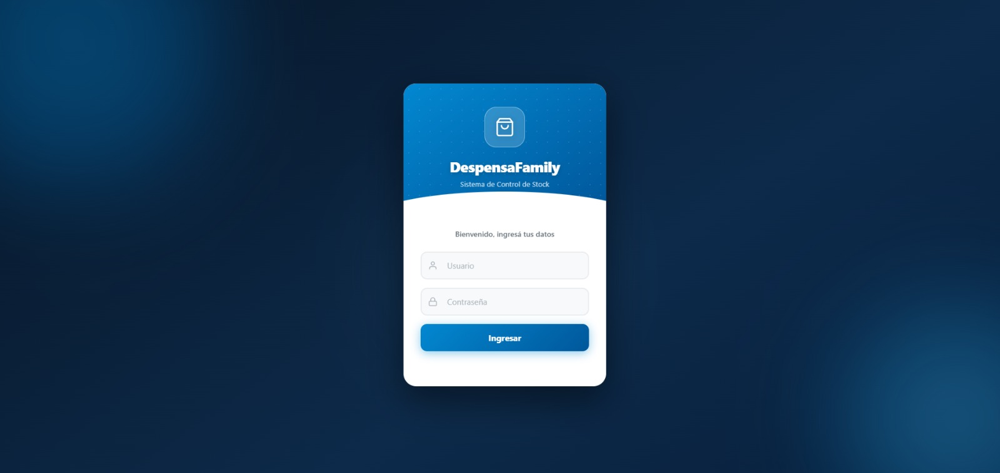
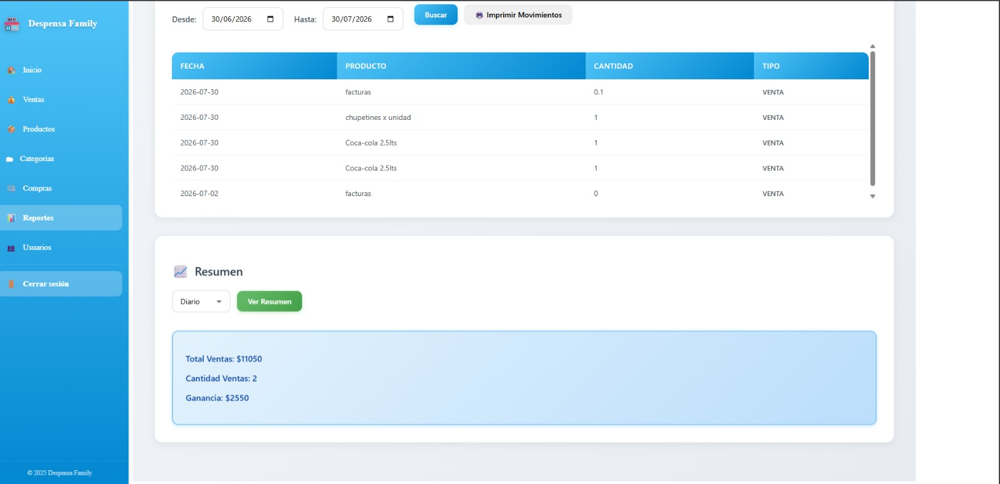
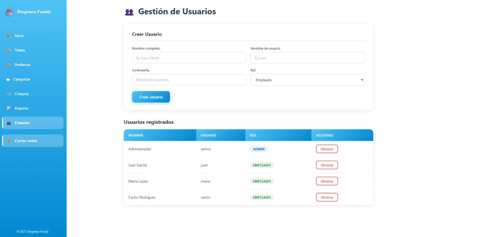
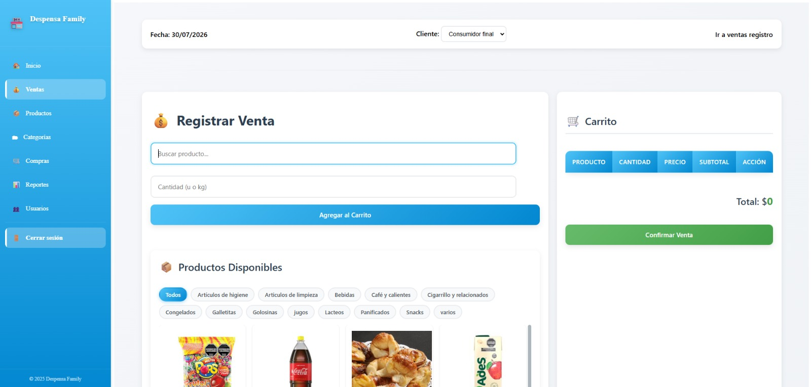
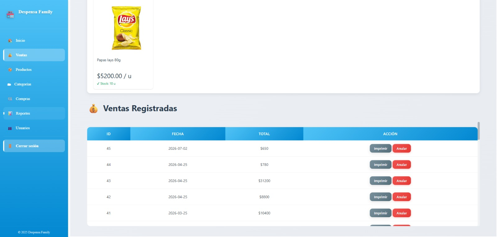
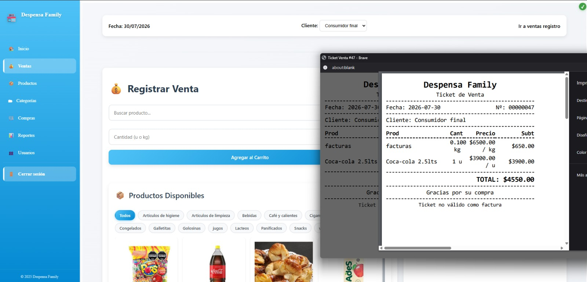

# DespensaFamily

Sistema de gestión comercial desarrollado para un negocio, orientado al control de stock, ventas y administración de productos.

## Descripción

**DespensaFamily** es una aplicación web desarrollada para facilitar la gestión diaria de un comercio. Permite administrar productos, controlar el stock disponible, registrar ventas y compras, generar reportes y gestionar usuarios con diferentes roles de acceso.

El objetivo del sistema es centralizar las operaciones del negocio en una sola plataforma, brindando una interfaz sencilla para la administración y el seguimiento de la información.

## Funcionalidades principales

### Gestión de productos y stock

* Alta, modificación y eliminación de productos.
* Control de cantidades disponibles.
* Organización de productos por categorías.
* Soporte para productos pesables.
* Actualización del stock mediante operaciones de compra y venta.

### Ventas

* Registro de ventas realizadas.
* Carrito de productos.
* Cálculo automático de totales.
* Generación e impresión de tickets.
* Consulta del historial de ventas.

### Compras

* Registro de compras de mercadería.
* Actualización automática del stock.
* Seguimiento de movimientos realizados.

### Reportes

* Visualización de información del negocio.
* Reportes de ventas y movimientos.
* Impresión de reportes.

### Usuarios y roles

* Gestión de usuarios del sistema.
* Control de permisos según el rol asignado.
* Roles de acceso como administrador y empleado.

## Tecnologías utilizadas

### Frontend

* HTML5
* CSS3
* JavaScript

### Backend

* Java
* Spring Boot
* Spring Security
* JWT para autenticación

### Base de datos

* MySQL

## Arquitectura

La aplicación está desarrollada con una arquitectura cliente-servidor:

* Frontend desarrollado con HTML, CSS y JavaScript.
* Backend desarrollado con Java y Spring Boot.
* Comunicación mediante API REST.
* Autenticación y autorización mediante JWT.

## Capturas de la aplicación

### Login

### Reportes

### Gestión de usuarios y roles

### Ventas

